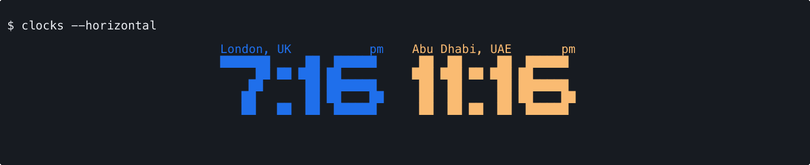
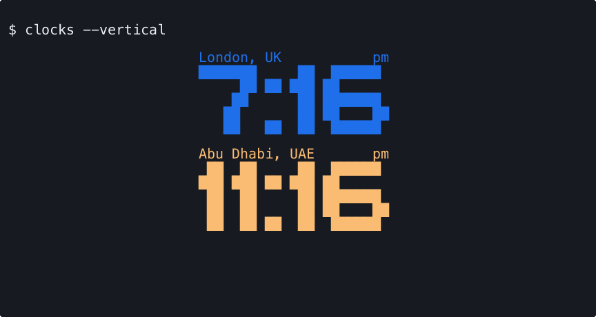
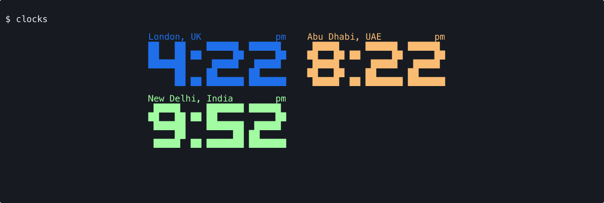
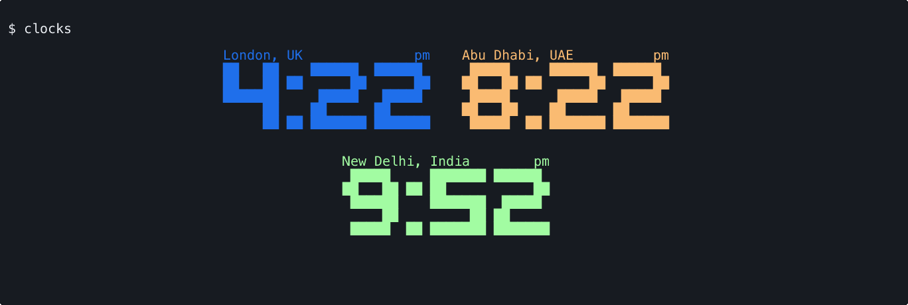
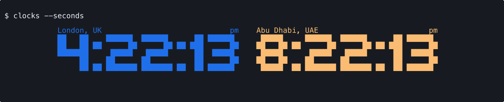

# clocks

clocks displays multiple timezones in your terminal, with customizable colors and layouts.


## Installation

### Linux or MacOS

You can install the latest version of clocks by running the following command in your terminal.

```bash
bash -c "$(curl -fsSL https://raw.githubusercontent.com/prnvbn/clocks/main/installer.sh)"
```

Move the binary to a directory in your PATH. For e.g. `/usr/local/bin` on linux.

### via `homebrew`

You can install `clocks` using the [prnvbn/homebrew-tap](https://github.com/prnvbn/homebrew-tap).

```bash
brew install prnvbn/tap/clocks
```

### via `go install`

```bash
go install github.com/prnvbn/clocks@latest
```

#### Enabling Command Autocompletion

To enable autocomplete, add the following to your `.bashrc` or `.bash_profile` file:

```bash
# you can also generate completions for zsh and fish shells by replacing bash with zsh or fish
source <(clocks completion bash)
```

> NOTE: dont forget to restart your terminal or run `source ~/.bashrc`

If you want use an alias for clocks, you can add the following to your `.bashrc` or `.bash_profile` file:

```bash
alias c=clocks
source <(clocks completion bash | sed 's/clocks/c/g')
```

## Getting Started

Run `clocks add` to add a clock, then `clocks` to display your clocks. Use `clocks edit` or `clocks remove` to manage them, and `clocks list` to list them without the time.

## Additional Features

### Layouts

Save a layout with `clocks layout`. Use `--horizontal` (`-H`) or `--vertical` (`-V`) to override it for one run.

| Horizontal | Vertical |
| --- | --- |
| `clocks --horizontal`<br> | `clocks --vertical`<br> |
| **Custom (Grid)**<br>`clocks layout`<br> | **Custom (Centered)**<br>`clocks layout`<br> |

### Seconds mode

Use `clocks --seconds` for one run, `clocks set --seconds` to save it, or `clocks unset --seconds` to disable it.


### 24 hour mode

To use 24 hour time, run `clocks unset --t12`, then run `clocks`. This saves your preference and removes the AM/PM indicators.

New configs use 12 hour time by default. Run `clocks set --t12` to switch back, or `clocks --t12` to use 12 hour time for one run.


### Live mode

Use `clocks --live` to keep clocks updating. Save it with `clocks set --live`, or disable it with `clocks unset --live`.

## Configuration

clocks is configured by a YAML file that will be auto-generated on first run with `twelveHour: true`. Existing configs keep their settings. By default, the config file is stored at `$XDG_CONFIG_HOME/clocks/config.yaml` when `XDG_CONFIG_HOME` is set, or `~/.config/clocks/config.yaml` on Linux and `~/Library/Application Support/clocks/config.yaml` on macOS. Run `clocks config` to see its path and contents. If you would like to store it elsewhere, you may export a `CLOCKS_CONFIG_PATH` environment variable that specifies its path:

```bash
export CLOCKS_CONFIG_PATH="<NEW_CONFIG_PATH>"
```

## Why

Sure, telling time in multiple places isn't rocket science. You could probably Google it or check your phone, however, I find this extremely annoying.

This annoyance is compounded when I am working on multiple projects simultaneously and monitoring different dashboards; thus leaving me with scarce screen real estate.

## Contributing

Feel free to open an issue or submit a pull request. I'm always open to suggestions and improvements :)
